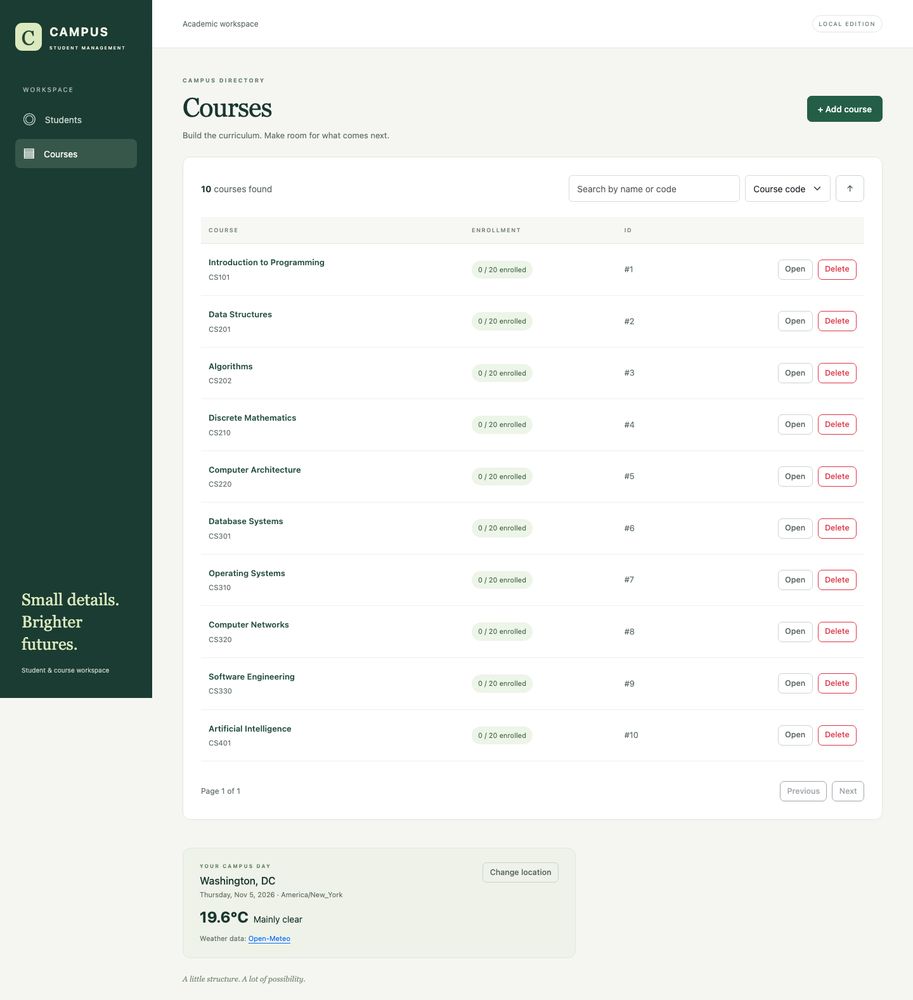
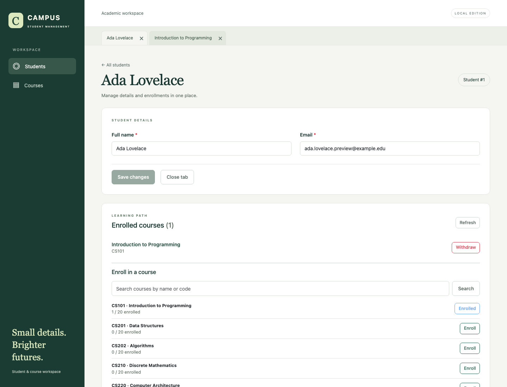

# Campus — Student Management

A full-stack take-home project for managing students, courses, and enrollments. It includes CRUD, searchable and sortable directories, pagination, editable work tabs, unsaved-change and deletion confirmations, form validation, and enrollment management. Weather defaults to **Washington, DC**, with manual city search and opt-in browser location showing **Current location**.





## Courses

These original computer science courses are seeded once, each with **20 seats**. Users can add, edit, and delete courses and change capacity. Duplicate enrollment is rejected; capacity cannot be reduced below current enrollment. Deleting a student or course removes its enrollments and preserves records on the other side.

| Code  | Course                      | Introduction                                                         |
| ----- | --------------------------- | -------------------------------------------------------------------- |
| CS101 | Introduction to Programming | Variables, control flow, functions, and problem solving.             |
| CS201 | Data Structures             | Lists, stacks, queues, trees, and hash tables.                       |
| CS202 | Algorithms                  | Complexity analysis, searching, sorting, and graph algorithms.       |
| CS210 | Discrete Mathematics        | Logic, sets, combinatorics, and proofs for computing.                |
| CS220 | Computer Architecture       | Processors, memory, instruction sets, and digital systems.           |
| CS301 | Database Systems            | Relational schemas, SQL, indexes, and transactions.                  |
| CS310 | Operating Systems           | Processes, concurrency, scheduling, and virtual memory.              |
| CS320 | Computer Networks           | Protocols, routing, reliable transport, and network applications.    |
| CS330 | Software Engineering        | Requirements, design, testing, and maintainable software delivery.   |
| CS401 | Artificial Intelligence     | Search, knowledge representation, and introductory machine learning. |

## Technology stack

| Area            | Technologies                                                                  |
| --------------- | ----------------------------------------------------------------------------- |
| Backend         | Java 21, Spring Boot 3.5.16, Spring MVC, Bean Validation, Maven Wrapper       |
| Persistence     | Spring Data JPA, **Hibernate ORM**, H2 file database, Flyway SQL migrations   |
| Frontend        | Angular 22, strict TypeScript/templates, Reactive Forms, RxJS                 |
| UI              | Bootstrap 5.3.8, ng-bootstrap 21                                              |
| External HTTP   | Spring `RestTemplate` calls Open-Meteo weather and city search APIs           |
| Tests           | JUnit 5, Mockito, MockMvc, Vitest, **Playwright / Chromium end-to-end tests** |
| Containers / CI | Docker Compose, Nginx, GitHub Actions                                         |

## Java services and database

The backend is one Spring Boot application with these service classes:

| Class               | Responsibilities                                                                                                          |
| ------------------- | ------------------------------------------------------------------------------------------------------------------------- |
| `ManagementService` | Student/course CRUD, enrollment and withdrawal, roster queries, uniqueness checks, capacity validation, and transactions. |
| `WeatherService`    | City search and current weather through `RestTemplate`, with connection/read timeouts.                                    |

`ManagementController` and `WeatherController` expose REST endpoints; `ApiExceptionHandler` provides consistent error responses. The three Spring Data repositories handle persistence.

**Hibernate is the JPA implementation** that maps Java entities to database tables and generates SQL. The persistence flow is:

```text
Java service → Spring Data JPA repository → Hibernate → JDBC → H2
```

Flyway creates and versions the schema; Hibernate validates the entity mappings against it at startup.

| Business table | Columns                                         | Purpose                                                         |
| -------------- | ----------------------------------------------- | --------------------------------------------------------------- |
| `students`     | `id`, `name`, `email`                           | Student records; email is unique.                               |
| `courses`      | `id`, `code`, `name`, `description`, `capacity` | Course records; code is unique.                                 |
| `enrollments`  | `id`, `student_id`, `course_id`, `enrolled_at`  | Student/course association; each student/course pair is unique. |

The association table supports both “a student's courses” and “a course's students.” IDs are database-generated. Transactions and course row locks prevent overbooking. Flyway also maintains its own `flyway_schema_history` metadata table.

## Choose a startup path

- **Docker:** follow the installation and startup instructions below. This builds Java, Angular, and H2 inside containers.
- **Local Java / Node:** follow [Run locally](docs/DEVELOPMENT.md#run-locally) using Java 21 and Node 22.22.3+ (22.x). This path has been exercised locally.

Docker schema validation passed; a full container build still requires Docker Engine and has not been executed in this environment.

## Install Docker

For macOS:

1. Download [Docker Desktop for Mac](https://docs.docker.com/desktop/setup/install/mac-install/), choosing **Apple silicon** or **Intel** for your Mac.
2. Open `Docker.dmg`, drag Docker to Applications, then launch Docker Desktop.
3. Complete its first-run setup and wait until the Docker engine is running. Docker Desktop includes Docker Compose.

For other systems, follow the official [Windows installation](https://docs.docker.com/desktop/setup/install/windows-install/) or [Linux Engine installation](https://docs.docker.com/engine/install/) and [Compose plugin installation](https://docs.docker.com/compose/install/linux/) instructions.

Open a terminal and verify installation:

```bash
docker --version
docker compose version
docker info
```

## Start and stop with Docker

Run from the repository root, where `compose.yaml` is located. Docker builds Java and Angular inside containers, so local Java, Node, Maven, and database installations are unnecessary for this startup path. The first build needs internet access. Ports **4200** and **8080** must be available; stop any locally running development servers first.

```bash
# Build and start both services in the background
docker compose up --build -d --wait

# Check containers and follow startup logs
docker compose ps
docker compose logs -f
```

Open **http://localhost:4200**. The backend is available at **http://localhost:8080/api/courses**. Compose waits for the backend health check before starting the frontend; `--wait` waits until both services are healthy. Ctrl+C exits log streaming; containers continue running.

```bash
# Stop and remove containers; retain database data
docker compose down

# Start again using existing images and retained data
docker compose up -d --wait
```

H2 data persists in the `student-data` named volume. To intentionally erase all application data and reset the seeded courses, use `docker compose down -v`, then start again. On macOS/Windows, quit Docker Desktop after stopping the application if you also want to stop Docker itself. Command reference: [Docker Compose quickstart](https://docs.docker.com/compose/gettingstarted/).

## Playwright end-to-end tests

The tests in [`frontend/e2e/workspace.spec.ts`](frontend/e2e/workspace.spec.ts) drive the Angular UI in Chromium against the **real Spring backend and H2 database**. Coverage includes CRUD, form validation, enrollment/withdrawal, work-tab drafts, confirmation dialogs, invalid record URLs, search/sort/pagination, weather, browser location, and mobile layout. API assertions also verify conflicts and deletion behavior.

This developer test path requires **Java 21 and Node.js 22.22.3+ (22.x)** locally:

```bash
# From the repository root: build and test the backend
cd backend
./mvnw verify

# Install frontend dependencies and Chromium, then run end-to-end tests
cd ../frontend
npm ci
npx playwright install chromium
npm run typecheck:e2e
npm run test:e2e
```

On Windows PowerShell, use `.\mvnw.cmd verify` in place of `./mvnw verify`.

Playwright automatically starts and stops isolated servers on **4201 / 8081** with a fresh **in-memory database**. It does not use the Docker deployment or modify its data. Weather responses are stubbed for reproducibility; the application's CRUD requests use the real backend. Failed tests save screenshots and traces under `frontend/test-results/`.

For non-Docker development, backend/frontend unit tests, and the full REST reference, see [development instructions](docs/DEVELOPMENT.md). See [verification notes](docs/REVIEW.md) and the [independent agent panel review](docs/PANEL_REVIEW.md) for executed checks, actual review votes, and remaining delivery conditions. Docker configuration is provided; container builds have not been verified in this environment.
