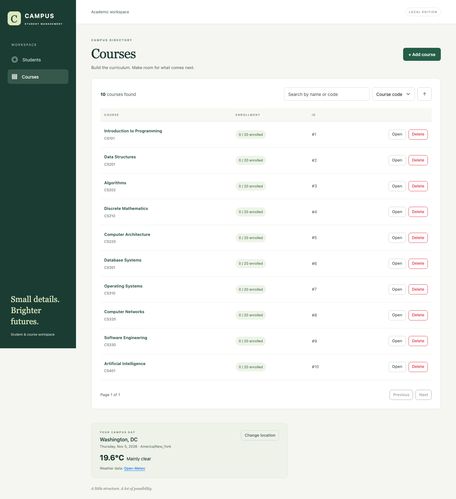
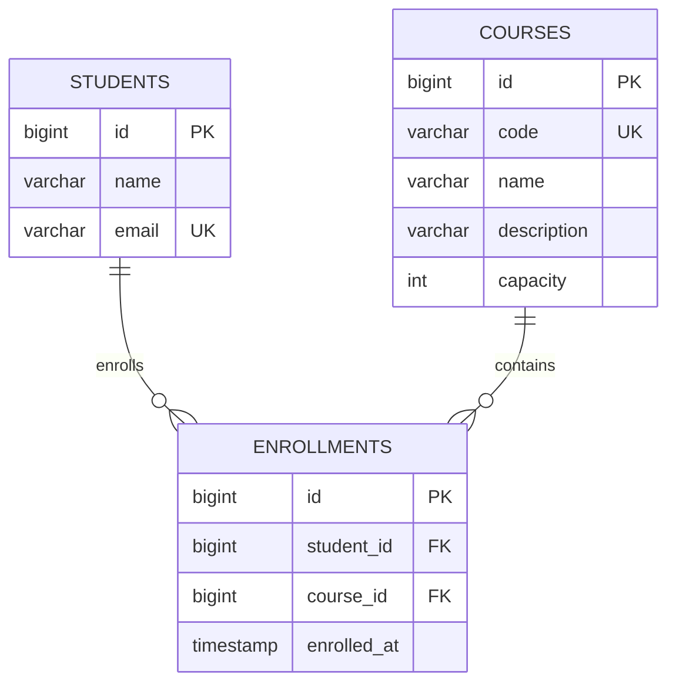

# Campus — Student Management

A focused Java 21 / Spring Boot / Angular application for managing students, courses, and enrollments. Built for the Full Stack (Java/Angular) take-home assignment.



## Run locally

Prerequisites: **Java 21**, **Node.js 22.12+ (22.x)**, npm, and an internet connection for the first dependency installation. Maven is downloaded by the checked-in Maven Wrapper; a global Maven installation is unnecessary.

```bash
# Terminal 1
cd backend
./mvnw spring-boot:run
```

```bash
# Terminal 2, from the repository root
cd frontend
npm ci
npm start
```

Open **http://localhost:4200**. The REST API runs at http://localhost:8080/api. Angular proxies API requests to Spring, so no permissive CORS configuration is needed. Direct links such as `/courses/1` work.

Alternatively, from the repository root:

```bash
./scripts/dev.sh
```

The helper starts both services and stops them on Ctrl+C. It also recognizes the ignored workspace-local tools installed during development. Standard Java/Node installations on PATH work for a fresh checkout.

### Docker alternative

With Docker Engine / Docker Desktop and Compose installed:

```bash
docker compose up --build
```

Open http://localhost:4200. The backend is also exposed on localhost:8080. Both published ports bind only to loopback. Docker builds run the backend tests and the Angular production build. A named volume retains the H2 database. `docker compose down` retains the data; `docker compose down -v` explicitly deletes it.

## What to try

1. Open **Courses**: ten original computer science courses are seeded, each with capacity 20.
2. Add a student with a name and unique email. Save to unlock enrollment management.
3. Enroll in a course. Already enrolled and full courses cannot be selected.
4. Open the course to see its roster. Withdraw from either side of the relationship.
5. Add or edit courses, including capacity. Capacity cannot be reduced below current enrollment.
6. Open several records. Each has a work tab; switching tabs preserves independent forms.
7. Change a form, then close its work tab: cancel keeps the draft; discard removes it. Leaving an editor for a directory asks for confirmation and retains its open draft. Refreshing or closing the browser invokes the native unsaved-changes warning. Drafts are intentionally not persisted across reloads.
8. Delete a student or course: confirm in the modal. Associated enrollments are removed; records on the other side remain.
9. Use **Change location** in the weather panel to search for a city or request browser location access.

Both directories support server-side search, sorting, and pagination. Form errors, loading states, empty results, conflicts, network errors, and success feedback are shown in English. The layout adapts to mobile screens.

## Weather and location

The default is **Washington, DC** (38.9072, -77.0369). Spring's **RestTemplate** calls [Open-Meteo Weather](https://open-meteo.com/en/docs) and [Geocoding](https://open-meteo.com/en/docs/geocoding-api); Angular calls Spring using `HttpClient`. No API key is required for this noncommercial demonstration. Provider attribution is visible in the UI.

Manual search returns up to five matching cities for explicit selection. **Use my location** requests browser permission only after a click. Coordinates are sent through Spring to Open-Meteo for weather and are not stored in the database. As requested, browser location displays **Current location**; there is no reverse-geocoding service or IP-based location lookup. A denied or unavailable location leaves manual search available. Browser geolocation requires localhost or HTTPS.

The date comes from the weather response in the selected location's timezone. Requests have a 3-second connection timeout and 5-second read timeout. Weather failure is isolated from student/course operations and has a retry action. Weather and city search require internet access; CRUD works offline after dependencies are installed.

## Verification

```bash
# Backend: unit tests, H2 integration/API tests, executable JAR
cd backend
./mvnw verify

# Frontend: unit tests and production build
cd ../frontend
npm ci
npm test
npm run build

# Real Chromium against the real Spring API
# Requires the backend JAR produced by ./mvnw verify above.
npx playwright install chromium
npm run test:e2e
```

Playwright starts its own servers on **8081 / 4201**, uses a fresh **in-memory H2 database**, and shuts them down afterward. It does not touch the normal file database. Weather responses are stubbed in browser tests for reproducibility; backend weather tests use an HTTP mock. Backend tests verify two simultaneous requests cannot take the same final seat. GitHub Actions runs the same checks and uploads browser traces on failure.

See [review and verification notes](REVIEW.md) for coverage and review outcomes. Docker definitions are provided but require a Docker environment for validation.

## Implementation

| Area                  | Choice                                                               |
| --------------------- | -------------------------------------------------------------------- |
| Backend               | Java 21, Spring Boot 3.5.16, Maven Wrapper 3.9.11                    |
| Persistence           | Spring Data JPA, H2 file database, Flyway migrations                 |
| Frontend              | Angular 22, standalone components, strict TypeScript, Reactive Forms |
| UI                    | Bootstrap 5.3.8 and ng-bootstrap 21                                  |
| State / communication | RxJS request streams and change events; a shared work-tab service    |
| Tests                 | JUnit 5, Mockito, MockMvc, H2, Vitest, Playwright                    |

```text
backend/                    Spring application, Maven Wrapper, Dockerfile
  src/main/java/.../        REST controllers, services, entities, repositories, DTOs
  src/main/resources/       Configuration and versioned SQL migrations
  src/test/java/.../        Business, API, transaction, concurrency and weather tests
frontend/                   Angular workspace, proxy config, Dockerfile, Nginx config
  src/app/                  Directories, editor, enrollments, weather and shared services
  e2e/                      Browser workflows against the real backend
.github/workflows/ci.yml    Automated verification
compose.yaml                Optional Docker startup
```

### Data model and invariants



One enrollment table supports queries in both directions. `(student_id, course_id)` is unique at the database level. Emails are normalized to lowercase; course codes to uppercase. IDs are database-generated and independent of editable fields.

All mutations execute inside service-layer transactions. Enrollment/withdrawal locks the student first, then the course. Course updates/deletion acquire the same course lock. This serializes the capacity check with enrollment insertion and capacity changes; database uniqueness remains the final duplicate safeguard. Student and course deletion remove enrollment rows in the same transaction, with database foreign-key cascades as an additional integrity safeguard. Entities never cross the API boundary; responses use DTOs. Validation failures use HTTP 400, missing records 404, business conflicts 409, and weather outages 503, with Problem Detail bodies.

Flyway creates the schema and seeds courses **once**, rather than re-inserting deleted courses on restart. H2 files live under `backend/data/` when started from `backend/`, or `/app/data/` in Docker. To reset local data, stop the backend and explicitly remove its `data/` directory. Do not run multiple backend processes against the same file database.

### REST endpoints

| Method | Path                                           | Behavior                                                        |
| ------ | ---------------------------------------------- | --------------------------------------------------------------- |
| GET    | `/api/students`, `/api/courses`                | Paged directory; `q`, `page`, `size`, `sort`, `direction`       |
| GET    | `/api/students/{id}`, `/api/courses/{id}`      | Record detail                                                   |
| POST   | `/api/students`, `/api/courses`                | Create; 201 with Location header                                |
| PUT    | `/api/students/{id}`, `/api/courses/{id}`      | Update                                                          |
| DELETE | `/api/students/{id}`, `/api/courses/{id}`      | Delete record and its enrollments; 204                          |
| GET    | `/api/students/{id}/enrollments`               | Student's enrolled courses                                      |
| GET    | `/api/courses/{id}/enrollments`                | Course's student roster                                         |
| POST   | `/api/students/{studentId}/courses/{courseId}` | Enroll; 201                                                     |
| DELETE | `/api/students/{studentId}/courses/{courseId}` | Withdraw; 204                                                   |
| GET    | `/api/weather`                                 | Current weather; optional `latitude`, `longitude` default to DC |
| GET    | `/api/weather/cities?name=Seattle`             | City search                                                     |

Page numbers start at zero; page size defaults to 10 and is capped at 100. Allowed sort fields are `id`, `name`, `email` for students and `id`, `name`, `code`, `capacity` for courses. Capacity is an integer from 1 to 100,000, defaulting to 20 in the UI. Student names and course names allow 100 characters, emails 254, course codes 20 letters/numbers/hyphens, descriptions 1,000.

## Deliberate scope

This is a local take-home project: no login, authorization, cloud deployment, global state framework, or microservices. Authentication was explicitly excluded. H2 keeps reviewer setup small. Editing uses last successful write wins; enrollment capacity is protected transactionally. Counts are queried per course for simplicity at this scale; a production-sized catalog would use aggregate projections and paginated rosters. External weather is an optional enhancement with independent availability.
